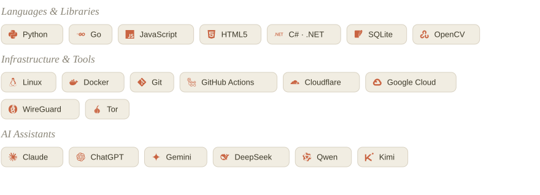
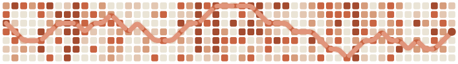

<!-- ============================================================
     MOX · ljy969 — profile README
     Design language: warm paper, terracotta accents, quiet serif.
     Every section header / banner / chip strip is a local SVG in
     assets/claude/ and follows GitHub's dark / light scheme via
     <picture> media queries.
     ============================================================ -->

  <strong>English</strong> · <a href="README.zh-CN.md">中文</a>

  <picture>
    <source media="(prefers-color-scheme: dark)" srcset="assets/claude/banner-en-dark.svg" />
    
  </picture>

<!-- 01 · about -->
<picture>
  <source media="(prefers-color-scheme: dark)" srcset="assets/claude/h-about-en-dark.svg" />
  
</picture>

> Hi, I'm **MOX** — a high school freshman. I keep exploring various technologies and accumulating programming experience, mostly by building small, zero-dependency things that run anywhere: offline-first web apps, network utilities, and little browser games.

<!-- 02 · tech stack -->
<picture>
  <source media="(prefers-color-scheme: dark)" srcset="assets/claude/h-tech-en-dark.svg" />
  
</picture>

<picture>
  <source media="(prefers-color-scheme: dark)" srcset="assets/claude/tech-en-dark.svg" />
  
</picture>

<!-- 03 · featured projects -->
<picture>
  <source media="(prefers-color-scheme: dark)" srcset="assets/claude/h-projects-en-dark.svg" />
  
</picture>

<table>
  <tr>
    <td width="50%" valign="top">

**[`Stock-simulator`](https://github.com/ljy969/Stock-simulator)** · `JavaScript` · ★ 96

A stress-free A-share stock trading simulator — all market data is generated and stored locally in the browser. Learn the rules, feel the swings, test strategies, zero risk.

`stock-simulator` `trading` `local-first`

    </td>
    <td width="50%" valign="top">

**[`Virtual-Identity-Generator`](https://github.com/ljy969/Virtual-Identity-Generator)** · `JavaScript` · ★ 11

A fully offline, zero-dependency web app that generates realistic synthetic identities for multiple countries and regions — no network requests, ever.

`offline` `privacy` `vanilla-js` `i18n`

    </td>
  </tr>
  <tr>
    <td width="50%" valign="top">

**[`DEAL-OR-NO-DEAL`](https://github.com/ljy969/DEAL-OR-NO-DEAL)** · `JavaScript` · ★ 9

A vanilla US *Deal or No Deal* clone — instant play, zero deps, no build, `file://` ready, bilingual, dark mode.

`browser-game` `vanilla-js` `web-audio`

    </td>
    <td width="50%" valign="top">

**[`tor-bridge-connectivity-tester`](https://github.com/ljy969/tor-bridge-connectivity-tester)** · `Go` · ★ 1

High-performance Tor bridge connectivity tester — auto-detects webtunnel / obfs4 / none transports, configurable concurrency, JSON / TXT / CSV export.

`tor` `webtunnel` `go`

    </td>
  </tr>
  <tr>
    <td width="50%" valign="top">

**[`Simple_Russian_Roulette`](https://github.com/ljy969/Simple_Russian_Roulette)** · `HTML` · ★ 1

A single-file browser Russian-roulette sim in pure HTML / CSS / JS — configurable cylinder, theme switching, sound feedback.

`single-file` `browser-game`

    </td>
    <td width="50%" valign="top">

**[`Cloudflare-request-viewing`](https://github.com/ljy969/Cloudflare-request-viewing)** · `JavaScript`

Track and visualize your Cloudflare usage — multi-account, auto-collection, light / dark themes, data stored locally only, Workers / Pages ready.

`cloudflare` `workers` `local-first`

    </td>
  </tr>
</table>

<!-- 04 · github stats -->
<picture>
  <source media="(prefers-color-scheme: dark)" srcset="assets/claude/h-stats-en-dark.svg" />
  
</picture>

<table>
  <tr>
    <td width="55%" valign="top" align="center">

<picture>
  <source media="(prefers-color-scheme: dark)" srcset="https://github-readme-stats.shion.dev/api?username=ljy969&show_icons=true&include_all_commits=true&count_private=false&bg_color=1B1A17&title_color=F2EFE7&text_color=C9C5B8&icon_color=D97757&border_color=36342E" />
  
</picture>

    </td>
    <td width="45%" valign="top" align="center">

<picture>
  <source media="(prefers-color-scheme: dark)" srcset="https://github-readme-stats.shion.dev/api/top-langs/?username=ljy969&layout=compact&include_all_commits=true&count_private=false&bg_color=1B1A17&title_color=F2EFE7&text_color=C9C5B8&border_color=36342E" />
  
</picture>

    </td>
  </tr>
</table>

  <picture>
    <source media="(prefers-color-scheme: dark)" srcset="https://streak-stats.demolab.com/?user=ljy969&background=1B1A17&border=36342E&stroke=36342E&ring=D97757&fire=D97757&currStreakNum=F2EFE7&sideNums=C9C5B8&currStreakLabel=D97757&sideLabels=8B877C&dates=8B877C&short_numbers=true" />
    
  </picture>

<!-- 05 · contribution graph (snake, regenerated daily by .github/workflows/snake.yml) -->
<picture>
  <source media="(prefers-color-scheme: dark)" srcset="assets/claude/h-contrib-en-dark.svg" />
  
</picture>

  <picture>
    <source media="(prefers-color-scheme: dark)" srcset="assets/claude/snake-dark.svg" />
    
  </picture>

<!-- 06 · star history -->
<picture>
  <source media="(prefers-color-scheme: dark)" srcset="assets/claude/h-stars-en-dark.svg" />
  
</picture>

  <a href="https://www.star-history.com/?repos=ljy969%2FVirtual-Identity-Generator%2Cljy969%2FDEAL-OR-NO-DEAL%2Cljy969%2Fljy969%2Cljy969%2FStock-simulator%2Cljy969%2FSimple_Russian_Roulette%2Cljy969%2FCloudflare-request-viewing%2Cljy969%2Ftor-bridge-connectivity-tester&type=date&legend=top-left">
    <picture>
      <source media="(prefers-color-scheme: dark)" srcset="https://api.star-history.com/chart?repos=ljy969/Virtual-Identity-Generator%2Cljy969/DEAL-OR-NO-DEAL%2Cljy969/ljy969%2Cljy969/Stock-simulator%2Cljy969/Simple_Russian_Roulette%2Cljy969/Cloudflare-request-viewing%2Cljy969/tor-bridge-connectivity-tester&type=date&theme=dark&legend=top-left&sealed_token=8D7wUQSztUG6-YDftwbuSOCN7sQKb4iQMRxzEvw4cVTgizA6GKtRqwclXmhpVCjO3vTcTlVYf_T1r_yGxjP_MQ7AzcCOct37x6Tv6R_tkkQdWct6IuyD6w" />
      <source media="(prefers-color-scheme: light)" srcset="https://api.star-history.com/chart?repos=ljy969/Virtual-Identity-Generator%2Cljy969/DEAL-OR-NO-DEAL%2Cljy969/ljy969%2Cljy969/Stock-simulator%2Cljy969/Simple_Russian_Roulette%2Cljy969/Cloudflare-request-viewing%2Cljy969/tor-bridge-connectivity-tester&type=date&legend=top-left&sealed_token=8D7wUQSztUG6-YDftwbuSOCN7sQKb4iQMRxzEvw4cVTgizA6GKtRqwclXmhpVCjO3vTcTlVYf_T1r_yGxjP_MQ7AzcCOct37x6Tv6R_tkkQdWct6IuyD6w" />
      
    </picture>
  </a>

<!-- 07 · trophies -->
<picture>
  <source media="(prefers-color-scheme: dark)" srcset="assets/claude/h-trophy-en-dark.svg" />
  
</picture>

  <picture>
    <source media="(prefers-color-scheme: dark)" srcset="https://github-profile-trophy.vercel.app/?username=ljy969&theme=gitdimmed&no-frame=true&no-bg=true&margin-w=8&margin-h=8" />
    
  </picture>

<!-- footer -->
<picture>
  <source media="(prefers-color-scheme: dark)" srcset="assets/claude/divider-dark.svg" />
  
</picture>

  <picture>
    <source media="(prefers-color-scheme: dark)" srcset="assets/claude/footer-en-dark.svg" />
    
  </picture>

  If you like this profile, you can <a href="https://github.com/ljy969/ljy969">Star the repo</a> — fork it freely if you want this look for your own page · <a href="LICENSE">MIT</a>

