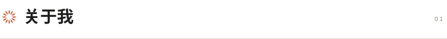
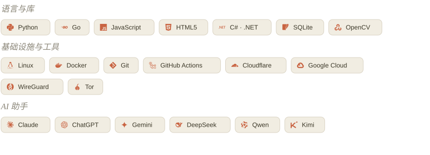
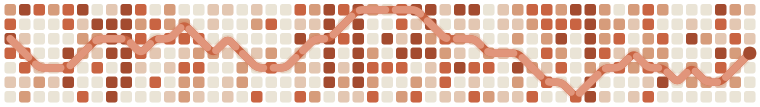

<!-- ============================================================
     MOX · ljy969 — 个人主页 README（中文版）
     设计语言：暖纸底色、陶土橘点缀、安静的衬线字。
     所有章节头 / 横幅 / 技术栈徽章均为 assets/claude/ 下的本地
     SVG，并通过 <picture> 媒体查询跟随 GitHub 深色 / 浅色模式。
     ============================================================ -->

  <a href="README.md">English</a> · <strong>中文</strong>

  <picture>
    <source media="(prefers-color-scheme: dark)" srcset="assets/claude/banner-zh-dark.svg" />
    
  </picture>

<!-- 01 · 关于我 -->
<picture>
  <source media="(prefers-color-scheme: dark)" srcset="assets/claude/h-about-zh-dark.svg" />
  
</picture>

> 你好，我是 **MOX**，一名高一学生。我持续探索各种技术、积累编程经验——喜欢做那些零依赖、随处可跑的小东西：离线优先的网页应用、网络工具，还有浏览器里的小游戏。

<!-- 02 · 技术栈 -->
<picture>
  <source media="(prefers-color-scheme: dark)" srcset="assets/claude/h-tech-zh-dark.svg" />
  
</picture>

<picture>
  <source media="(prefers-color-scheme: dark)" srcset="assets/claude/tech-zh-dark.svg" />
  
</picture>

<!-- 03 · 精选项目 -->
<picture>
  <source media="(prefers-color-scheme: dark)" srcset="assets/claude/h-projects-zh-dark.svg" />
  
</picture>

<table>
  <tr>
    <td width="50%" valign="top">

**[`Stock-simulator`](https://github.com/ljy969/Stock-simulator)** · `JavaScript` · ★ 96

纯娱乐、零压力的 A 股模拟炒股平台：行情数据全部在浏览器本地生成与存储，不连接任何真实行情接口。练规则、感受波动、测试策略，全程无资金风险。

`stock-simulator` `trading` `local-first`

    </td>
    <td width="50%" valign="top">

**[`Virtual-Identity-Generator`](https://github.com/ljy969/Virtual-Identity-Generator)** · `JavaScript` · ★ 11

完全离线、零依赖的网页应用：为多个国家 / 地区生成逼真的合成虚拟身份，纯本地运行，不发起任何网络请求。

`offline` `privacy` `vanilla-js` `i18n`

    </td>
  </tr>
  <tr>
    <td width="50%" valign="top">

**[`DEAL-OR-NO-DEAL`](https://github.com/ljy969/DEAL-OR-NO-DEAL)** · `JavaScript` · ★ 9

纯前端复刻美版《Deal or No Deal》：即开即玩，也是可学可改的游戏与前端架构范例；零依赖零构建、`file://` 直开、中英双语、深暗主题。

`browser-game` `vanilla-js` `web-audio`

    </td>
    <td width="50%" valign="top">

**[`tor-bridge-connectivity-tester`](https://github.com/ljy969/tor-bridge-connectivity-tester)** · `Go` · ★ 1

高性能 Tor 网桥连通性测试工具：自动识别 webtunnel / obfs4 / none 传输协议并采用针对性探测策略，支持并发配置与 JSON / TXT / CSV 多格式导出。

`tor` `webtunnel` `go`

    </td>
  </tr>
  <tr>
    <td width="50%" valign="top">

**[`Simple_Russian_Roulette`](https://github.com/ljy969/Simple_Russian_Roulette)** · `HTML` · ★ 1

纯 HTML / CSS / JavaScript 实现的浏览器端俄式轮盘模拟游戏：支持自定义弹巢配置、主题切换与音效反馈，单文件即可运行。

`single-file` `browser-game`

    </td>
    <td width="50%" valign="top">

**[`Cloudflare-request-viewing`](https://github.com/ljy969/Cloudflare-request-viewing)** · `JavaScript`

功能完整的 Cloudflare 使用情况追踪与可视化应用：多账户管理、自动数据采集、深浅主题切换，数据仅存本地，兼容 Workers / Pages 部署。

`cloudflare` `workers` `local-first`

    </td>
  </tr>
</table>

<!-- 04 · 数据一览 -->
<picture>
  <source media="(prefers-color-scheme: dark)" srcset="assets/claude/h-stats-zh-dark.svg" />
  
</picture>

<table>
  <tr>
    <td width="55%" valign="top" align="center">

<picture>
  <source media="(prefers-color-scheme: dark)" srcset="https://github-readme-stats.shion.dev/api?username=ljy969&show_icons=true&include_all_commits=true&count_private=false&bg_color=1B1A17&title_color=F2EFE7&text_color=C9C5B8&icon_color=D97757&border_color=36342E" />
  
</picture>

    </td>
    <td width="45%" valign="top" align="center">

<picture>
  <source media="(prefers-color-scheme: dark)" srcset="https://github-readme-stats.shion.dev/api/top-langs/?username=ljy969&layout=compact&include_all_commits=true&count_private=false&bg_color=1B1A17&title_color=F2EFE7&text_color=C9C5B8&border_color=36342E" />
  
</picture>

    </td>
  </tr>
</table>

  <picture>
    <source media="(prefers-color-scheme: dark)" srcset="https://streak-stats.demolab.com/?user=ljy969&locale=zh&background=1B1A17&border=36342E&stroke=36342E&ring=D97757&fire=D97757&currStreakNum=F2EFE7&sideNums=C9C5B8&currStreakLabel=D97757&sideLabels=8B877C&dates=8B877C&short_numbers=true" />
    
  </picture>

<!-- 05 · 贡献热力图（贪吃蛇由 .github/workflows/snake.yml 每日自动重新生成） -->
<picture>
  <source media="(prefers-color-scheme: dark)" srcset="assets/claude/h-contrib-zh-dark.svg" />
  
</picture>

  <picture>
    <source media="(prefers-color-scheme: dark)" srcset="assets/claude/snake-dark.svg" />
    
  </picture>

<!-- 06 · 星标历史 -->
<picture>
  <source media="(prefers-color-scheme: dark)" srcset="assets/claude/h-stars-zh-dark.svg" />
  
</picture>

  <a href="https://www.star-history.com/?repos=ljy969%2FVirtual-Identity-Generator%2Cljy969%2FDEAL-OR-NO-DEAL%2Cljy969%2Fljy969%2Cljy969%2FStock-simulator%2Cljy969%2FSimple_Russian_Roulette%2Cljy969%2FCloudflare-request-viewing%2Cljy969%2Ftor-bridge-connectivity-tester&type=date&legend=top-left">
    <picture>
      <source media="(prefers-color-scheme: dark)" srcset="https://api.star-history.com/chart?repos=ljy969/Virtual-Identity-Generator%2Cljy969/DEAL-OR-NO-DEAL%2Cljy969/ljy969%2Cljy969/Stock-simulator%2Cljy969/Simple_Russian_Roulette%2Cljy969/Cloudflare-request-viewing%2Cljy969/tor-bridge-connectivity-tester&type=date&theme=dark&legend=top-left&sealed_token=8D7wUQSztUG6-YDftwbuSOCN7sQKb4iQMRxzEvw4cVTgizA6GKtRqwclXmhpVCjO3vTcTlVYf_T1r_yGxjP_MQ7AzcCOct37x6Tv6R_tkkQdWct6IuyD6w" />
      <source media="(prefers-color-scheme: light)" srcset="https://api.star-history.com/chart?repos=ljy969/Virtual-Identity-Generator%2Cljy969/DEAL-OR-NO-DEAL%2Cljy969/ljy969%2Cljy969/Stock-simulator%2Cljy969/Simple_Russian_Roulette%2Cljy969/Cloudflare-request-viewing%2Cljy969/tor-bridge-connectivity-tester&type=date&legend=top-left&sealed_token=8D7wUQSztUG6-YDftwbuSOCN7sQKb4iQMRxzEvw4cVTgizA6GKtRqwclXmhpVCjO3vTcTlVYf_T1r_yGxjP_MQ7AzcCOct37x6Tv6R_tkkQdWct6IuyD6w" />
      
    </picture>
  </a>

<!-- 07 · 里程碑奖杯 -->
<picture>
  <source media="(prefers-color-scheme: dark)" srcset="assets/claude/h-trophy-zh-dark.svg" />
  
</picture>

  <picture>
    <source media="(prefers-color-scheme: dark)" srcset="https://github-profile-trophy.vercel.app/?username=ljy969&theme=gitdimmed&no-frame=true&no-bg=true&margin-w=8&margin-h=8" />
    
  </picture>

<!-- 页脚 -->
<picture>
  <source media="(prefers-color-scheme: dark)" srcset="assets/claude/divider-dark.svg" />
  
</picture>

  <picture>
    <source media="(prefers-color-scheme: dark)" srcset="assets/claude/footer-zh-dark.svg" />
    
  </picture>

  如果你喜欢这个主页，欢迎 <a href="https://github.com/ljy969/ljy969">点个 Star</a>；想用同款设计也可以直接 Fork。· <a href="LICENSE">MIT</a>

